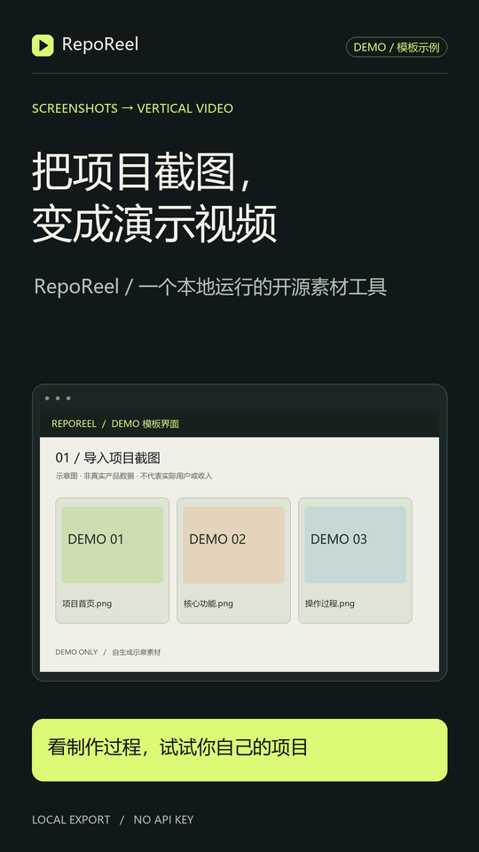

# RepoReel

**Your screenshots. Your story. A vertical project demo.**

RepoReel is a small, local Python CLI for developers and creators who need to explain an AI tool or GitHub project in Chinese. Give it project screenshots and a JSON storyboard; get a **1080 × 1920 silent MP4**, a cover, captions, a recording script, and a publishing draft. No login, paid service, API key, or automatic publishing.



The included screenshots are **synthetic DEMO templates**, visibly labelled throughout. They are not a customer product, a performance benchmark, or evidence of revenue. The default script is a written template, **not an AI-generated script**. You can write your own storyboard or have an agent prepare it.

[中文说明](docs/zh-CN.md)

## See the result

[Watch the 30-second narrated DEMO](https://github.com/LancelotDDJ/reporeel/releases/download/v0.1.0/reporeel-30s-a-publication.mp4) · [Download the v0.1.0 preview](https://github.com/LancelotDDJ/reporeel/releases/tag/v0.1.0)

The demo has separately added synthetic narration; the CLI itself exports silent video. It was made before the first public release, so its reference to source coming later is historical. The source and downloads are now public. This is a prerelease, with no verified audience-growth or revenue result.

## Quick start

Requires Python 3.10+, Pillow, a Chinese-capable font, and FFmpeg with `libx264` for video. Windows Microsoft YaHei, macOS PingFang, and Linux Noto Sans CJK are detected in common system locations.

Clone the repository and run from its root directory. If using the source ZIP instead, extract it and open a terminal in the directory containing `pyproject.toml`; skip the first two commands.

```bash
git clone https://github.com/LancelotDDJ/reporeel.git
cd reporeel
python -m pip install -e .
reporeel doctor
reporeel sample demo
reporeel build demo/storyboard.json --out output/first-demo
```

If the shell cannot find the installed command, use `python -m reporeel` in its place. For FFmpeg outside PATH:

```bash
reporeel doctor --ffmpeg "/path/to/ffmpeg"
reporeel build demo/storyboard.json --out output/first-demo --ffmpeg "/path/to/ffmpeg"
```

Without FFmpeg, `doctor` exits with status 1 and reports `video_ready: false`. If `images_ready` is `true`, image and text exports still work; use the following command instead of the video build:

```bash
reporeel build demo/storyboard.json --out output/stills --images-only
```

Use `--font /path/to/font.ttf` or the `REPOREEL_FONT` environment variable to choose a font. `REPOREEL_FFMPEG` can supply the executable path. FFmpeg is an external dependency and is not bundled; use a build whose licence is appropriate for your distribution.

## What it exports

| File | Purpose |
| --- | --- |
| `reel.mp4` | H.264, 1080 × 1920, 30 fps, **no audio track**; absent with `--images-only` |
| `cover.png` | Vertical cover with your hook, screenshot, and call to action |
| `frames/scene-01.png`, … | Full-resolution scene cards with on-screen narration |
| `voiceover.txt` | Timed Chinese recording script; no speech synthesis is performed |
| `captions.srt` | External UTF-8 subtitles, timed to the storyboard |
| `publish.md` | Title, post body, tags, disclosure and real URL or clearly labelled placeholder |
| `manifest.json` | SHA-256 and byte size of the storyboard, source screenshots and outputs |
| `timeline.ffconcat` | Reusable timeline for the local encoder |

MP4 export uses static scene cards and a narration strip. Runtime is rounded to the nearest 1/30 second; the manifest preserves the requested storyboard runtime too. Version 0.1 does not provide animated transitions, TTS, music, web scraping or a graphical editor. Images and source content never leave the machine. The CLI itself makes no network requests.

## Bring your own project

Run `reporeel sample my-story`, replace the images in `my-story/assets/`, then edit `storyboard.json`:

```json
{
  "version": 1,
  "demo": true,
  "title": "把项目截图，变成演示视频",
  "tagline": "本地运行，不需要 API Key",
  "cta": "看制作过程，试试自己的项目",
  "project_url": "",
  "scenes": [
    {
      "headline": "项目做出来了，怎么让人看懂？",
      "detail": "用真实截图讲清核心价值。",
      "narration": "准备三张截图，把你的项目讲成一个短故事。",
      "screenshot": "assets/demo-01.png",
      "duration": 6
    }
  ]
}
```

Set `demo` to `false` only when replacing the example with your actual project. Enter a real project URL or leave it empty: RepoReel never invents repository links. You remain responsible for the accuracy and publication rights of supplied content.

The format is intentionally narrow:

- Required top-level fields: `version: 1`, explicit boolean `demo`, `title` (≤32 characters), `tagline` (≤60), `cta` (≤32), and `scenes`. `project_url` is optional, empty or HTTP(S).
- Each of 1–12 scenes requires `headline` (≤32), `detail` (≤80), `narration` (≤80), `screenshot` and `duration` (2–30 seconds). Total runtime is at most 180 seconds. Short scripts are easiest to read and record.
- Screenshots must be PNG/JPEG/WebP, at least 64 × 64 and at most 30 megapixels. Paths are relative to the JSON file and must remain inside its directory, including after symlink resolution.
- The output folder must be new or empty, and separate from the source directory and its ancestors. Existing files are never overwritten. Use a fresh output directory for each build.
- Use UTF-8 JSON. Newlines and control characters inside individual text fields are rejected. Long text is fitted into the template rather than silently cropped.

Only publish verified feature claims. The tool does not predict followers, stars or sales. Measure those separately using real evidence.

## Demo requests and first-run feedback

[Discuss a 20–30 second project demo](https://github.com/LancelotDDJ/reporeel/issues/new?template=project-demo.yml) with one feature, a public project link and assets you may publish. Availability, scope and any fees are agreed separately; submitting a brief does not place an order. The CLI is available under MIT.

[Share your first-run result](https://github.com/LancelotDDJ/reporeel/issues/new?template=first-run.yml), successful or otherwise. Both forms create public issues: share only sanitized text, never credentials, private screenshots or full sensitive logs.

## Development

```bash
python -m pip install -e .
python -m unittest discover -s tests -v
```

Unit tests cover input validation, path confinement, timing, overwrite protection and source integrity. A local integration check can use FFprobe alongside FFmpeg:

```bash
ffprobe -v error -show_entries stream=codec_name,width,height,r_frame_rate:format=duration -of json output/first-demo/reel.mp4
```

For a full integration check, `python tests/verify_video.py demo/storyboard.json output/first-demo --ffmpeg /path/to/ffmpeg --ffprobe /path/to/ffprobe` checks codec, dimensions, duration, frame count, absence of audio, and decodes each scene midpoint to compare it against the rendered PNG. It requires both encoder tools and a built sample.

If encoding fails, the CLI returns a nonzero status and leaves the PNGs and scripts available for inspection. It does not claim the export succeeded. Try a new output folder after correcting the encoder or input.

Contributions welcome: a reproducible bug, a focused usability fix, or an original demo is a good first contribution. MIT licensed; see [LICENSE](LICENSE).
